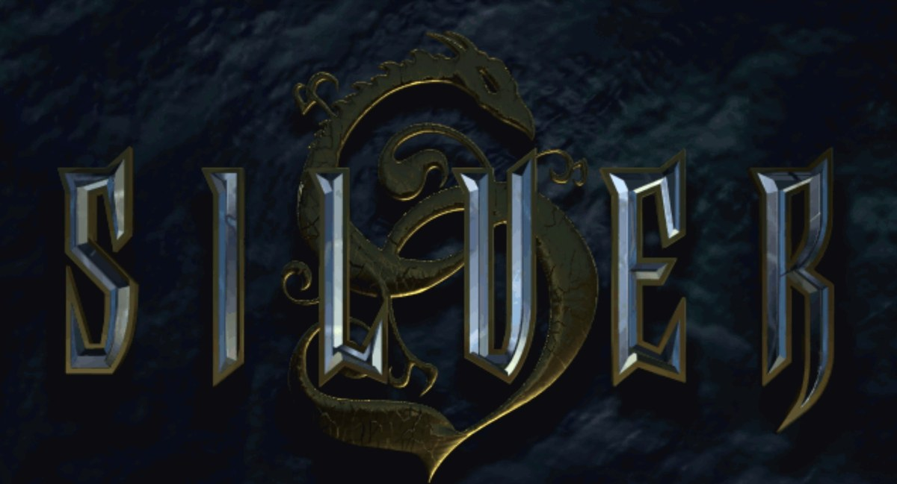
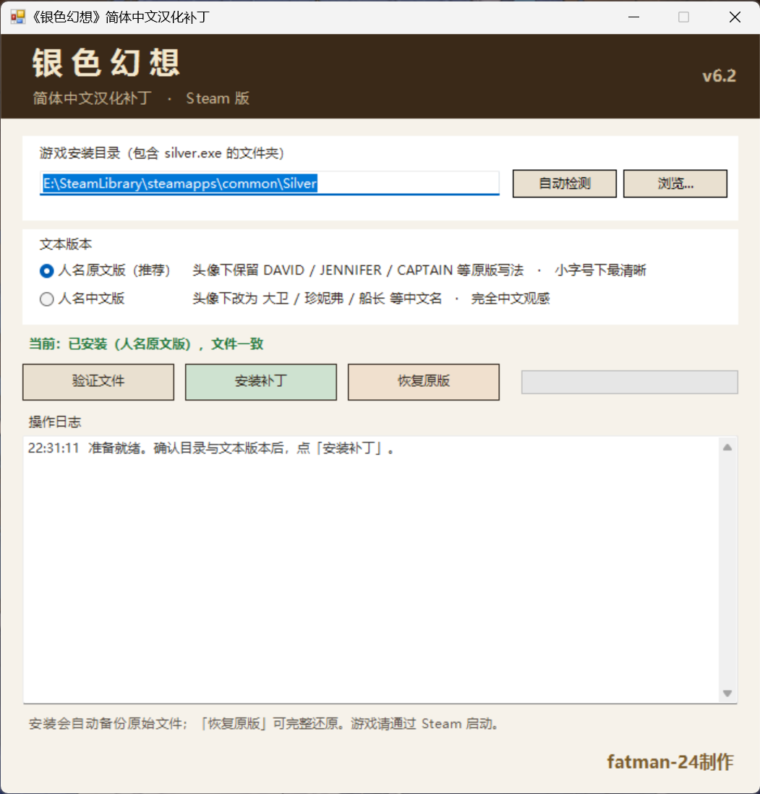
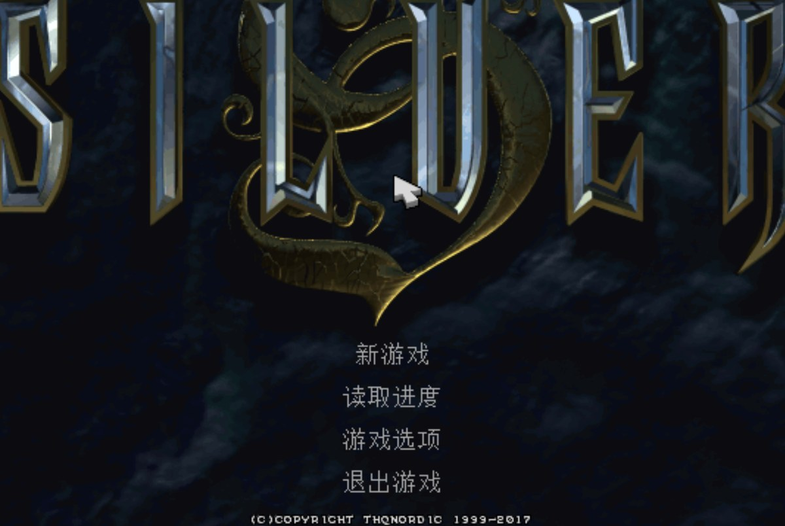
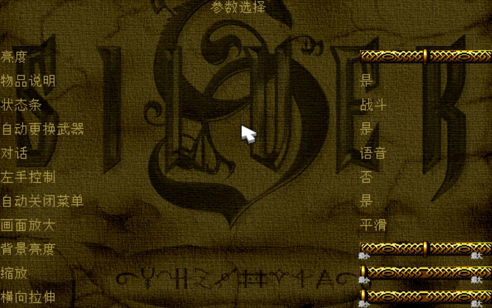
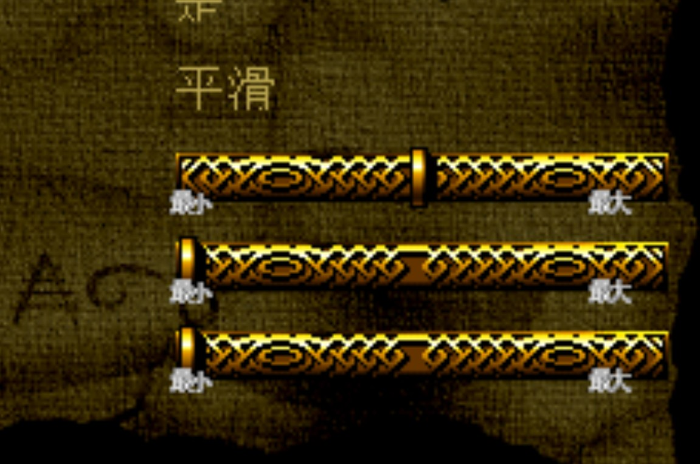
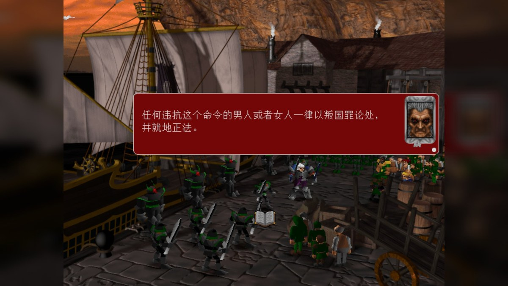
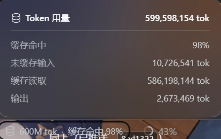

> Silver Simplified Chinese Patch
> 《银色幻想》简体中文汉化补丁



## 一、项目背景

《银色幻想》（Silver）是由 Infogrames 英国曼彻斯特分部开发、Infogrames 于 1999 年发行的奇幻动作角色扮演游戏，先后登陆 Windows、Mac OS 与 Dreamcast；2017 年 6 月由 THQ Nordic 重新发行于 Steam。

故事发生在被暴君术士「白银」（Silver）统治的贾拉群岛。主角戴维（David）与妻子珍妮弗（Jennifer）、祖父生活在维丹特的森林里；白银为挑选新王后而下令掳掠各地妇女，珍妮弗被白银之子富吉（Fuge）抓走。戴维一行踏上追寻与反抗之路，最终集齐八颗魔法球、推翻白银，并击败借机现世的恶魔「天启」。

游戏采用 3D 角色叠加预渲染背景的俯视视角，以鼠标划动方向来施展劈砍突刺的实时战斗为核心特色。发售后评价两极：战斗系统、场景美术与全程语音广受好评，而存档点式存档、地图导航与队伍管理则饱受批评。作为一款试图在主机 RPG 黄金年代争一席之地的欧美作品，它至今仍有不少值得亲自体验的独到之处。

由于年代久远，本作从未提供官方简体中文支持，语言一直是中文玩家深入体验的主要障碍。本项目希望在尽可能保留原作表现与玩法的前提下，为这部经典游戏提供完整、自然的中文体验。

* * *

## 二、汉化内容

本汉化并非只覆盖菜单，而是对游戏内可见的各类文本做了系统性整理：

### 1. 游戏界面

- 主菜单、设置菜单及各级子菜单。
- 操作设置、画面设置与高级选项。
- 物品栏、道具名称与说明文字。
- 任务提示、状态信息与系统消息。
- 新建存档、载入界面与各类确认/提示框。

### 2. 剧情与游戏文本

- 主线剧情、任务目标与旁白。
- 全部人物对白（含港口、酒馆、王宫、地牢等全部关卡的对话）。
- 教程文字、机关提示与交互信息。
- 地图名称、场景说明及书籍/铭牌文本。

上述对白文本总计入库 **2452 条**，全部复用了 1999 年中文光盘版的既有译文作为基础。

### 3. 人名与「人名版本」

头像下显示的角色名（说话人字段）共 **57 个名字**。原光盘版对其中一部分做了汉化，导致同一场戏里中英文人名混排，而该位置字号极小，汉字相当难认。

因此本补丁提供两个版本，**除人名外完全相同**：

- **人名原文版（推荐）**：头像下保留 `DAVID` / `JENNIFER` / `CAPTAIN` 等原版拉丁写法，小字号下最清晰，观感与原版一致。
- **人名中文版**：头像下改为 `大卫` / `珍妮弗` / `船长` 等中文名，适合追求完全中文观感的玩家。

两个版本可在安装界面直接切换，无需下载不同压缩包。

### 4. 中文字体与显示适配

- 重建 **6 套位图字库**（主界面、系统字体、小字号、地图、中等字号、二级系统字体），共 **1560 个汉字字形**，全部由 SimSun 现渲染，尺寸与行距遵循原版规格。
- 中文按原版字号参与引擎原生渲染，不依赖任何外部文字覆盖层。
- 对白长句按字换行，对话框可完整读完并点击翻页。

* * *

## 三、技术说明

《银色幻想》是典型的 90 年代末自研引擎 PC 游戏：文本、字库与 UI 绘制全部由游戏自己管理，没有任何现成的本地化通道。因此本项目的工作量主要在于**把它的文本与字形系统摸清楚，再原地扩展成能容纳中文的形态**，而不是简单地替换几个文本文件。

### 1. 文本资源格式与编码分析

游戏关卡文本存放在 `silver\levels\**\*.eng`，共 119 个文件。其格式为：

- 前 56 字节头部，**首个 32 位整数字段记录文件长度**；
- 其后为 NUL 分隔的字段序列，条目形如 `……对话文本 / 角色 ID / 说话人名 / 颜色 / 空`；
- 整文件使用一段 **64 字节自反 XOR 密钥**加密。

分析中还确认了两点对补丁至关重要的约束：

- 游戏是 32 位 MSVC PE，**镜像开启了 ASLR**，且没有可用的重定位空间 ⇒ 运行时补丁**绝不能写入绝对地址**，所有跳转必须相对当前指令。
- 修改文本后**必须同步回写头部的文件长度字段**，否则引擎解析到的字段序列会错位。

### 2. 中文字典与字形重建

1999 年的中文版采用双字节自定义编码：每个汉字占用 2 字节，槽位号由两字节低位拼接而成（`b0 = 0x80 | (slot & 0x7F)`，`b1 = 0x80 | ((slot >> 7) & 0x7F)`，槽位自 0x100 起）。

据此重建了整套中文映射，并用 SimSun 重新渲染 6 套位图字库；随后把中文光盘版的译文按该编码重新写入 `.eng` 文件。过程中发现引擎原逻辑是**一个字节对应一条字形记录**，直接写入双字节汉字会导致乱码，因此在文本构建函数内插入了**汉字配对**处理：读入两个字节、合成一个槽位、只产出**一条**字形记录，并让源指针前进 2 字节。对于极少数编码不规范的调用，还在字形绘制入口加了参数修正，避免"传入小于 0x1000 的值被当成字形地址"导致的场景切换崩溃。

### 3. 对白绘制与换行机制修复

对白由文本构建函数（入口 `0x49F080`）生成字形记录数组，再由绘制函数（入口 `0x4D8880`）逐条绘制，其中 `0x3E8`/`0x3E9`/`0x3EA` 分别表示换行、空格与分页标记。

汉化过程中修复了三处问题，这里按定位顺序记录：

**① 换行边界只认空格**

引擎只在遇到**空格、回车或 NUL** 时才记录"可换行位置"，而中文整句没有空格。一旦行宽超过上限，它只能回退到**整串开头** ⇒ 这一页永远读不完、对话框点不掉、点鼠标只有语音继续。

改法是让**每一个汉字都成为合法换行边界**——把边界记录分支的条件跳转改为落回保存块本身（`0x49F150` 处 1 个字节：`jne 0x49F17A` → `jne 0x49F152`）。此后中文按字换行、分页正常。

**② 回退时指针与下标错位一个字符**

上述改动之后，每次换行会**丢掉一个汉字**。原因是引擎回退时把数组下标减 1，却把字符串指针恢复到"下一个字符"的位置——两者相差一个字符（汉字相差 2 字节），于是触发换行的那个字被跨过去。

修法是在回退处**同步把字符串指针也回退一个字符**：判断前一个字节是否为双字节字符的尾字节（`cmp al, 0x80`），是则减 2，否则减 1。该逻辑以 44 字节的补丁桩实现（`0x49F115` → 桩 `0x4A7A62`），避免了"直接结束本页"这类看似简单、实际会让引擎内部状态错位的改法。

**③ 切场景崩溃**

字形绘制入口收到某些非字形参数时会越界访问，表现为切换场景瞬间崩溃。在入口处加入参数修正后问题消失。

### 4. 文本校对（两轮）

原光盘版译文本身存在数量可观的错别字与误译。本项目使用**本地部署的大语言模型（Qwen3.8-27B，llama.cpp）**做了两轮校对：

- **第一轮：纯中文自查** —— 检查错别字、漏字、语句不通。检查 2210 条，标记 220 条，确认修改 **238 处**。
- **第二轮：与原版英文逐句对照** —— 检查误译、漏译、多译。比对 1727 组英中句对，模型报出 978 条问题（其中误译 902、漏译 46、多译 26）。

第二轮有一个值得记录的教训：**模型返回的 JSON 序号并不可靠**，直接按序号回填会让建议落到别的句子上（例如把「……没有时间听一个老傻瓜叙述他的历史」改成「闭嘴！」）。最终改为用**相似度闸门**（`difflib` 相似度 ≥ 0.45）过滤，只采纳"确实是对同一句的修改"的建议，共修正 **382 处**，其余一律不采用。

两轮合计修正 **620 处**，全部经过结构、解码与缺字校验后才写入，并保留完整的建议清单供人工复核。

### 5. 自动化构建与完整性验证

整个项目由一套 Python 工具链驱动，负责译文本地化、字表生成、位图字库重建、`.eng` 重编码、校对结果应用、补丁构建与全量校验。

- 基于 SHA-256 的原版/补丁指纹识别与版本校验。
- 全量结构校验：字段数一致性、逐字段可解码、字符全部落在字表内。
- 字库往返回读校验，确保重建后的字形与编码一致。
- 安装器全量manifest记录，支持**精确可逆**的一键还原。

安装与卸载都不修改注册表、不创建系统卸载项，只备份被覆盖的文件，因此可以随时干净还原。

* * *

## 四、安装方法

《银色幻想》简体中文汉化补丁安装器

本汉化补丁适配 **Steam 版《银色幻想》**，请先确认游戏已安装并可正常启动。

1. 从下方下载最新版简体中文汉化补丁，解压到任意目录。
2. 双击 `安装汉化.bat`，无需安装任何额外运行库（仅使用 Windows 自带的 PowerShell）。
3. 安装器会**自动检测** Steam 游戏目录；若未检测到，请点「浏览…」选择包含 `silver.exe` 的目录（通常是 `...\steamapps\common\Silver`）。
4. 在「文本版本」中选择 **人名原文版（推荐）** 或 **人名中文版**。
5. 点击「安装补丁」，等待完成（首次安装会自动备份原始文件）。
6. **请通过 Steam 启动游戏**（库 → Silver → 开始）。

注意事项：

- **必须从 Steam 启动**。游戏带有 DRM 校验，直接双击游戏目录内的 `silver.exe` 会立即自动退出，这不是汉化造成的问题。
- 建议使用未经修改的原版游戏。若安装过其他 MOD，文件校验可能无法通过。
- 安装器会在游戏目录建立 `_zh_patch_backup` 备份目录，**请勿删除**，否则无法还原。
- 本补丁不修改注册表、不创建系统卸载项，并会保留现有设置与存档。
- 若 Windows 提示「未知发布者」或将其标记为来自网络：可右键压缩包 → 属性 → 勾选「解除锁定」后再解压；弹窗时选择「更多信息」→「仍要运行」即可。补丁未购买商业代码签名证书，因此不会显示可信发布者。

### 卸载汉化

重新运行 `安装汉化.bat`，选择已安装汉化的游戏目录，点击「恢复原版」，即可通过备份完整还原原始文件，无需重新下载或校验游戏。

* * *

## 五、游戏截图

中文主菜单

参数选择页

小字体中文（物品说明）

剧情对白（按字换行，长句自动分页，对话框可读完并点击翻页）

* * *

## 六、下载地址

[GitHub Releases](https://github.com/fatman24/silver-cn-patch/releases)

[百度网盘](https://pan.baidu.com/s/1QzvYcs3MuY1rauMF108vhQ?pwd=ccvi) 提取码: `ccvi`

> 百度网盘内文件名是「银色幻想汉化补丁_v6.2.zip」，与 GitHub 上的「Silver_CN_Patch_v6.2.zip」内容完全相同（同一份 SHA-256），下载任意一处即可。

**文件校验（v6.2 综合包）**

```
文件: Silver_CN_Patch_v6.2.zip
大小: 7.16 MB
SHA-256: c197efaf4bf524d54257bdfba62f8dfd48870f4f7c77ad9f6f8e47d67caf402c
直链   : https://github.com/fatman24/silver-cn-patch/releases/download/v6.2/Silver_CN_Patch_v6.2.zip
```

包内含：`安装汉化.bat` / `诊断.bat` / `silver_gui.ps1` / `install.ps1` / `卸载汉化.bat`，以及两套文本与 12 套字库。

本汉化补丁免费提供，不包含游戏本体。使用前请自行准备受支持的[正版游戏](https://store.steampowered.com/app/606680/Silver/)。

* * *

## 七、问题反馈

由于原版游戏年代久远，其引擎、文本与字形系统均存在一定限制，汉化过程中难免有遗漏和问题。若在游玩中遇到以下情况，欢迎反馈：

- 文本漏译、错译或专有名词不统一。
- 中文字体缺字、乱码、截断或重叠。
- 对白换行异常、对话框读不完或点不掉。
- 人名版本切换后显示不正确。
- 安装、还原及其他兼容性问题。

**交流群**：QQ 群 **777183055**（汉化补丁的问题反馈与交流）

**推荐**：[群主的博客 · 伯翎飞云](https://blog.blfy.cc/posts/)

反馈时最好附上**游戏版本、出现问题的关卡或场景、复现步骤与截图**；若涉及崩溃，也欢迎附上相关日志以便定位。

需要注意，本项目为非官方汉化补丁，无法保证兼容所有非官方游戏版本与第三方 MOD。

* * *

## 八、最后

《银色幻想》即使在发售当年，它的存档点设计、地图导航和队伍操作也称不上友好，放到今天这些不便只会更明显。

但它同样有自己的独到之处：预渲染背景上流动的光影、鼠标划动出招的手感、全程语音撑起的剧情演出，还有那个时代欧美 RPG 少见的野心。

对我来说，为老游戏做汉化并不是要把它们包装成完美无缺的经典，而只是**消除语言这道门槛**，让今天的玩家仍然有机会亲自体验、理解并评价这些作品。

或许它们早已离开主流视野，但只要还有人愿意重新打开它们，它们就不该只是游戏史上的一个名字。

希望这份汉化能让更多中文玩家走进贾拉群岛，看一看那片森林、港口与王宫。

* * *

## 鸣谢

感谢以下作品、项目与社区为本次汉化提供的基础和参考：

- Infogrames 英国曼彻斯特分部（后独立为 Spiral House）：开发了 1999 年的《银色幻想》。
- THQ Nordic 与 Steam：让这部作品得以在现代 PC 平台上重新发行。
- 1999 年中文光盘版汉化的各位前辈：本项目全部对白译文的基础均来自他们的工作。
- [llama.cpp](https://github.com/ggml-org/llama.cpp) 与 Qwen 模型：为两轮文本校对提供本地推理支持。
- SimSun（中易宋体）：为位图字库重建提供字形基础。
- 所有仍在关注经典 PC 游戏、致力于老游戏保存与兼容性研究的玩家和开发者。

最后，感谢每一位下载、体验并反馈问题的玩家。

**补丁制作：fatman-24 和 偷吃白饭600M的大肥鱼**

本次汉化从头到尾消耗的 token —— 约 6 亿，缓存命中 98%
**原发布页：https://fatman24.cc/posts/silver-cn-patch/ **